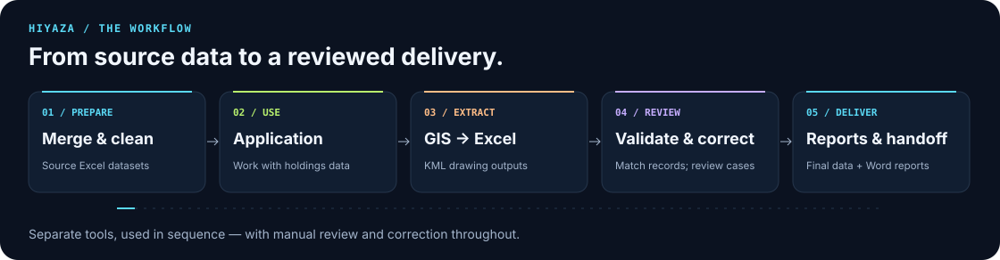

<!-- Profile README for mustafaelbaz5. Custom animated SVGs are stored in assets/. -->

  

  

  
  
  

  <a href="#about-me">About</a> &nbsp; / &nbsp;
  <a href="#current-work">Current work</a> &nbsp; / &nbsp;
  <a href="#selected-projects">Projects</a> &nbsp; / &nbsp;
  <a href="#technical-toolkit">Toolkit</a> &nbsp; / &nbsp;
  <a href="#github-activity">Activity</a>

## About me

I'm **Mustafa Elbaz**, a **Software Developer** with a foundation in **Flutter and Dart**, building practical solutions across **mobile applications, data processing, automation, and GIS**.

I start with the problem: understand the workflow, plan a useful solution, build it step by step, and improve it through real use. My work includes both **developing the software** and **preparing the data and tools that make it useful**.

> **My focus:** useful applications · reliable data · less repetitive work · better technical delivery.

| Applications | Data & automation | GIS & delivery |
| :--- | :--- | :--- |
| Features, business logic, state management, backend integration | Cleaning, mining, validation, record matching, Python tools and SQL | ArcGIS Pro, KML/Excel workflows, review, reporting and handoff |

## Current work

**Software Developer · Civil · Full-time**  
**June 2026 — Present**

I take responsibility for the **technical work across applications, tools, data workflows, GIS, and final delivery** on an agricultural holdings digitization project delivered through Civil to **[Digital Smart Tree (DST)](https://www.linkedin.com/company/dstegypt/)**. The national initiative involves the **Future of Egypt for Sustainable Development** and the **Ministry of Agriculture and Land Reclamation**.

- **Application development:** built and continue to develop **Hiyaza**, including its features and business logic, with a supporting web dashboard.
- **Data processing & quality:** work with substantial volumes of holdings and parcel data, performing **cleaning, mining, normalization, validation, matching, and correction**.
- **Tools & automation:** develop **Python scripts, SQL queries, and internal tools**, and use **RPA** to reduce repetitive work and support the operational workflow.
- **GIS & delivery:** work with **ArcGIS Pro** and **KML/Excel** outputs, review unresolved records, and prepare corrected datasets, statistics, and **Word delivery reports**.
- **Continuous improvement:** troubleshoot issues and refine the tools and processing steps as new requirements and real-world problems appear.

  

These are **separate tools operated in sequence**, with review and correction between stages. I develop, maintain, and use them as part of the day-to-day work.

## Selected projects

<table>
  <tr>
    <td width="50%" valign="top">
      <h3>01 / Hiyaza Finder</h3>
      
A Flutter application for working with agricultural holdings and parcel records. Search, review and edit data, with local data handling and Supabase integration.

      
<strong>Flutter · Dart · BLoC · Supabase</strong>

      <a href="https://github.com/mustafaelbaz5/hiyaza-finder">Explore the app ↗</a> &nbsp; · &nbsp; <a href="https://github.com/mustafaelbaz5/hiyaza-app-dashboard">Supporting dashboard ↗</a>
    </td>
    <td width="50%" valign="top">
      <h3>02 / Data Preparation & Validation</h3>
      
Tools for merging and cleaning source Excel files, normalizing Arabic names, matching records, and surfacing uncertain cases for manual review. Additional correction tooling uses local SQLite lookups.

      
<strong>Python · pandas · openpyxl · SQLite</strong>

      <a href="https://github.com/mustafaelbaz5/hiyaza-app-py-merge-script">Explore the preparation tool ↗</a>
    </td>
  </tr>
  <tr>
    <td width="50%" valign="top">
      <h3>03 / Hiyaza Report Generator</h3>
      
A desktop tool that analyzes finalized Excel datasets, calculates delivery statistics, and fills a formatted Word template for agricultural association reports.

      
<strong>Python · openpyxl · python-docx</strong>

      <a href="https://github.com/mustafaelbaz5/hiyaza_report_gen">Explore reporting ↗</a>
    </td>
    <td width="50%" valign="top">
      <h3>04 / IM Legends</h3>
      
A competitive match-tracking app with player statistics, match history, leaderboards, authentication and notifications. Includes development/production flavors and automated tester distribution.

      
<strong>Flutter · Supabase · Firebase · Fastlane</strong>

      <a href="https://github.com/mustafaelbaz5/clash-arena">Explore the project ↗</a>
    </td>
  </tr>
</table>

## Technical toolkit

### Application development

  
  
  
  

**BLoC / Cubit** · State management · Dependency injection · Clean architecture principles · Authentication · Local storage · Notifications

### Data, scripting & automation

  
  
  
  
  

**Data cleaning** · Data mining · Data processing · Validation · Data quality · Transformation · Record matching · Arabic text normalization · Task automation · RPA · Report generation

### GIS & supporting tools

  
  
  
  
  

**KML ↔ Excel workflows** · Git & GitHub · GitHub Actions · Fastlane · Firebase App Distribution · Development/production environments

**Development workflow:** GitFlow-style branches · Conventional Commits · Semantic Versioning  
**Design & development tools:** Figma · Android Studio

<strong>Supporting web work</strong>

I've also used **React and TypeScript**, with AI assistance, to build a supporting dashboard for data upload, review, publishing and application controls. My main focus remains **application development, data tools, automation, and GIS workflows**.

## How I build & keep learning

- **Problem first:** analyze the work, sketch an initial flow, then iterate on the solution.
- **AI-assisted workflow:** choose tools for the task — research, planning, analysis, automation or implementation. I use **OpenAI Codex** and **Claude Code** as coding assistants while reviewing and refining the output.
- **Aviation direction:** studying **Aviation Information Systems**, with a long-term interest in applying software to aviation problems.
- **Hands-on growth:** continuously improve my understanding through projects, debugging and day-to-day technical responsibilities.

## GitHub activity

  

<strong>Explore repository statistics, languages & recent activity</strong>

<table>
  <tr>
    <td width="50%"></td>
    <td width="50%"></td>
  </tr>
</table>

  
  

<strong>The contribution trail</strong>

<picture>
  <source media="(prefers-color-scheme: dark)" srcset="https://raw.githubusercontent.com/mustafaelbaz5/mustafaelbaz5/output/github-snake-dark.svg" />
  <source media="(prefers-color-scheme: light)" srcset="https://raw.githubusercontent.com/mustafaelbaz5/mustafaelbaz5/output/github-snake.svg" />
  
</picture>

## Let's connect

Interested in **useful applications, data tools, automation, GIS, or aviation-related software**? I'd be happy to connect.

**[Portfolio](https://mustafa-portfolio-eight.vercel.app/)** · **[LinkedIn](https://www.linkedin.com/in/mustafa-elbaz-725a6631a/)** · **[m9stafa05@gmail.com](mailto:m9stafa05@gmail.com)**

  

