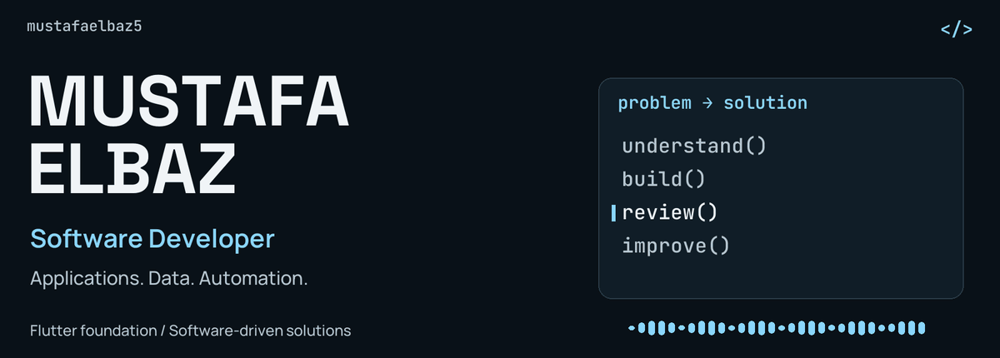
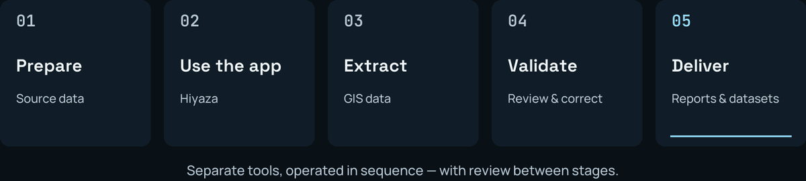

<!-- Upload README.md and assets/ to mustafaelbaz5/mustafaelbaz5. -->

<picture>
  <source media="(prefers-reduced-motion: reduce) and (max-width: 600px)" srcset="./assets/hero-mobile.png" />
  <source media="(prefers-reduced-motion: reduce)" srcset="./assets/hero.png" />
  <source media="(max-width: 600px)" srcset="./assets/hero-mobile.gif" />
  
</picture>

  
  
  

<picture>
  <source media="(prefers-reduced-motion: reduce) and (max-width: 600px)" srcset="./assets/focus-mobile.png" />
  <source media="(prefers-reduced-motion: reduce)" srcset="./assets/focus.png" />
  <source media="(max-width: 600px)" srcset="./assets/focus-mobile.gif" />
  
</picture>

<a href="#about-me">About</a> &nbsp; / &nbsp; <a href="#current-work">Current work</a> &nbsp; / &nbsp; <a href="#selected-projects">Projects</a> &nbsp; / &nbsp; <a href="#technical-toolkit">Toolkit</a> &nbsp; / &nbsp; <a href="#github-activity">Activity</a>

## About me

I'm **Mustafa Elbaz**, a **Software Developer** with a foundation in **Flutter and Dart**, building practical solutions across **mobile applications, data processing, automation, and GIS**.

I start with the problem: understand the workflow, plan a useful solution, build it step by step, and improve it through real use. My work includes developing the software and preparing the data and tools that make it useful.

**Useful applications. Reliable data. Less repetitive work. Better technical delivery.**

| Applications | Data & automation | GIS & delivery |
| --- | --- | --- |
| Features, business logic, state management and backend integration | Cleaning, mining, validation, record matching, Python and SQL | ArcGIS Pro, KML/Excel workflows, review, reporting and handoff |

## Current work

**Software Developer · Civil · Full-time**  
**June 2026 — Present**

I take responsibility for technical work across **applications, tools, data workflows, GIS, and final delivery** on an agricultural holdings digitization project delivered through Civil to **[Digital Smart Tree (DST)](https://www.linkedin.com/company/dstegypt/)**. The national initiative involves the **Future of Egypt for Sustainable Development** and the **Ministry of Agriculture and Land Reclamation**.

<picture>
  <source media="(prefers-reduced-motion: reduce) and (max-width: 600px)" srcset="./assets/workflow-mobile.png" />
  <source media="(prefers-reduced-motion: reduce)" srcset="./assets/workflow.png" />
  <source media="(max-width: 600px)" srcset="./assets/workflow-mobile.gif" />
  
</picture>

*Separate tools operated in sequence, with review and correction between stages. I develop, maintain, and use them in day-to-day work.*

<strong>Explore my responsibilities at Civil</strong>

- **Application development:** built and continue to develop **Hiyaza**, including features and business logic, with a supporting web dashboard.
- **Data processing & quality:** clean, mine, normalize, validate, match, and correct substantial volumes of holdings and parcel data.
- **Tools & automation:** develop **Python scripts, SQL queries, and internal tools**, and use **RPA** to reduce repetitive work.
- **GIS & delivery:** work with **ArcGIS Pro** and **KML/Excel** outputs, review unresolved records, and prepare corrected datasets, statistics, and **Word delivery reports**.
- **Continuous improvement:** troubleshoot issues and refine tools and processing steps as requirements and real-world problems appear.

<picture><source media="(prefers-reduced-motion: reduce)" srcset="./assets/divider.png" /></picture>

## Selected projects

### Hiyaza Finder

A Flutter application for agricultural holdings and parcel records: **search, review, and edit**, with local data handling and Supabase integration.

   

**[Explore the app →](https://github.com/mustafaelbaz5/hiyaza-finder)** · [Supporting dashboard](https://github.com/mustafaelbaz5/hiyaza-app-dashboard)

### Data Preparation & Validation

Tools for merging and cleaning source Excel files, normalizing Arabic names, matching records, and surfacing uncertain cases for manual review. Additional correction tooling uses local SQLite lookups.

**Python · pandas · openpyxl · SQLite**  
**[Explore the preparation tool →](https://github.com/mustafaelbaz5/hiyaza-app-py-merge-script)**

### Hiyaza Report Generator

A desktop tool that analyzes finalized Excel datasets, calculates delivery statistics, and fills a formatted Word template for agricultural association reports.

**Python · openpyxl · python-docx**  
**[Explore reporting →](https://github.com/mustafaelbaz5/hiyaza_report_gen)**

### IM Legends

A competitive match-tracking app with player statistics, match history, leaderboards, authentication and notifications. Includes development/production flavors and automated tester distribution.

**Flutter · Supabase · Firebase · Fastlane**  
**[Explore the project →](https://github.com/mustafaelbaz5/clash-arena)**

## Technical toolkit

| Application development | Data, scripting & automation | GIS & supporting tools |
| --- | --- | --- |
| Flutter · Dart · Supabase · Firebase | Python · SQL · pandas · openpyxl · SQLite | ArcGIS Pro · GIS · Excel · KML |
| BLoC / Cubit · Dependency injection | Cleaning · Mining · Validation · Matching | Review · Reporting · Technical delivery |

<strong>Explore development skills, tools & workflow</strong>

**Application development:** BLoC / Cubit, state management, dependency injection, clean architecture principles, authentication, local storage, and notifications.

**Data and automation:** Data cleaning, data mining, data processing, validation, data quality, transformation, record matching, Arabic text normalization, task automation, RPA, and report generation.

**GIS and delivery:** ArcGIS Pro, GIS, Excel, KML ↔ Excel workflows, review, reporting, and handoff.

**Development workflow:** Git & GitHub, GitHub Actions, Fastlane, Firebase App Distribution, development/production environments, GitFlow-style branches, Conventional Commits, and Semantic Versioning.

**Design and development tools:** Figma and Android Studio.

<strong>Supporting web work — React & TypeScript</strong>

I've also used **React and TypeScript**, with AI assistance, to build a supporting dashboard for data upload, review, publishing, and application controls. My main focus remains **application development, data tools, automation, and GIS workflows**.

## How I build & keep learning

- **Problem first:** analyze the work, sketch an initial flow, then iterate on the solution.
- **AI-assisted workflow:** choose tools for research, planning, analysis, automation, or implementation. I use **OpenAI Codex** and **Claude Code** as coding assistants while reviewing and refining the output.
- **Aviation direction:** studying **Aviation Information Systems**, with a long-term interest in applying software to aviation problems.
- **Hands-on growth:** improve my understanding through projects, debugging, and day-to-day technical responsibilities.

<picture><source media="(prefers-reduced-motion: reduce)" srcset="./assets/divider.png" /></picture>

## GitHub activity

  
  

<strong>Explore repository statistics, languages & recent activity</strong>

<picture>
  <source media="(prefers-color-scheme: dark)" srcset="https://raw.githubusercontent.com/mustafaelbaz5/mustafaelbaz5/output/github-snake-dark.svg" />
  <source media="(prefers-color-scheme: light)" srcset="https://raw.githubusercontent.com/mustafaelbaz5/mustafaelbaz5/output/github-snake.svg" />
  
</picture>

## Let's connect

Interested in **useful applications, data tools, automation, GIS, or aviation-related software**? I'd be happy to connect.

**[Portfolio](https://mustafa-portfolio-eight.vercel.app/)** · **[LinkedIn](https://www.linkedin.com/in/mustafa-elbaz-725a6631a/)** · **[m9stafa05@gmail.com](mailto:m9stafa05@gmail.com)**

<picture>
  <source media="(prefers-reduced-motion: reduce) and (max-width: 600px)" srcset="./assets/footer-mobile.png" />
  <source media="(prefers-reduced-motion: reduce)" srcset="./assets/footer.png" />
  <source media="(max-width: 600px)" srcset="./assets/footer-mobile.gif" />
  
</picture>

<!-- Bundled GIFs need no Actions setup. Existing remote metrics and snake images
still depend on the profile repository's existing generation workflows. -->
